# 🧬 Pokémon Auto Chess (PAC v6.11) — RL Community League, Set-Transformer & VIPER Heuristic Lab

[](https://www.python.org/)
[](https://pytorch.org/)
[](https://gymnasium.farama.org/)
[](https://scikit-learn.org/)

Laboratório de **Aprendizado por Reforço Multi-Agente (Comunidade de Modelos)** combinado com **Métodos Clássicos de Busca e Destilação Simbólica (VIPER)** construído sobre os dados e regras reais do jogo open-source [**Pokémon Auto Chess (`keldaanCommunity/pokemonAutoChess`)**](https://github.com/keldaanCommunity/pokemonAutoChess).

---

## 🎯 Motivação do Projeto

Ao contrário do *Teamfight Tactics (TFT)*, o **Pokémon Auto Chess (PAC)** possui pouquíssimo conteúdo analítico, estatísticas de meta ou replays públicos disponíveis na internet. Como o código-fonte do jogo é aberto, este projeto resolve o problema criando uma **Comunidade de Agentes de Aprendizado por Reforço** onde cada agente treina com uma **função de recompensa distinta** (por sinergia/tipo, economia de juros 50g, *Hyper-Roll* de 1g, *Tempo Win-Streak* e *Lose-Streak Cashout*) e compete em lobbies de 8 jogadores para:

1. **Descobrir matematicamente as melhores heurísticas de jogo** para cada uma das **31 sinergias oficiais** e para cada arquétipo econômico.
2. **Mapear os Pokémon Recordistas de Dano (Melhor Carry / DPS) e Recordistas de Tank (Melhor Frontline)** dentro de cada composição.
3. **Destilar as redes neurais PyTorch em Árvores de Decisão legíveis (`SE ... ENTÃO ...`)** usando o algoritmo **VIPER** (`scikit-learn`).
4. **Exportar Relatórios PDF Vetoriais + Pacotes JSON/Prompt prontos para análise por IA**.

---

## 🏗️ Arquitetura Híbrida (Deep RL + Métodos Clássicos)

```mermaid
flowchart LR
    subgraph Dados["📦 Dados Oficiais PAC (data/)"]
        CSV["pokemons-data.csv\n(1.077 Pokémon, 31 Sinergias)"]
        BOTS["botv2.json\n(726 Bots da Comunidade)"]
    end

    subgraph Ambiente["🎮 Ambiente Gymnasium (8 Jogadores)"]
        ENV["PokemonAutoChessGymEnv\nAction Masking (22 Ações)\nJuros 50g, Reroll 1g, XP 4g\nEvoluções 1*->2*->3*"]
        SIM["FastCombatSimulator (6x4)\nARMOR_FACTOR = 0.05\nTelemetria de Dano & Tank"]
        SURR["SetTransformerCombatSurrogate\n(PyTorch MultiheadAttention)\n90.7%+ Val Accuracy"]
    end

    subgraph Comunidade["🧬 Comunidade de Modelos RL (PBT + MAP-Elites)"]
        AG1["Standard Econ 50g\n(Fast-8/9 Compounder)"]
        AG2["Hyper-Roll 1g\n(Caçador de 3 Estrelas)"]
        AG3["Tempo Win-Streak\n(Pressão de Nível/HP)"]
        AG4["Lose-Streak Cashout\n(Economia Reversa + Pivot)"]
        AG5["31 Especialistas de Tipo\n(FIRE, WATER, DRAGON, FIGHTING...)"]
    end

    subgraph Saida["📊 Destilação & Relatórios (resultados/)"]
        VIPER["VIPER Policy Distiller\n(Árvores SE...ENTÃO...)"]
        PDF["Relatório PDF Multi-Página\n(Gráficos + Tabelas + Recordes)"]
        AIPACK["Pacote JSON (7 Blocos) +\nPROMPT_PARA_IA_ANALISAR.md"]
    end

    Dados --> Ambiente
    Ambiente --> Comunidade
    Comunidade --> Saida
```



---

## 📂 Estrutura do Repositório (Dois Experimentos: CPU & GPU em Escala)

O repositório está organizado em **duas suítes complementares**:

| Pasta / Script | Propósito | Hardware Alvo |
| :--- | :--- | :--- |
| 📁 **[`pac_rl/`](./pac_rl/)** + [`run_pac_python.py`](./run_pac_python.py) | **Experimento Base (CPU)**: Comunidade de 8 Agentes RL (`RewardConditionedMaskedActorCritic`), `SetTransformerCombatSurrogate` (`d_model=64`), Torneio Head-to-Head, Recordes de Dano/Tank das 31 Sinergias e Destilação VIPER. | **Qualquer PC / Notebook (CPU)** (~10 min) |
| 🚀 **[`experimento_gpu_escala/`](./experimento_gpu_escala/)** | **Experimento Massivo para GPU (CUDA + AMP FP16)**: Mega Comunidade de **35 Agentes RL** (todas as 31 Sinergias + 4 Economias Puras), `DeepSetTransformerSurrogate` de 4 camadas (`d_model=256, nhead=8`) com Cross-Attention inter-times, Arquivo MAP-Elites completo ($31 \times 4 = 124$ células) e Matriz de Counters $31 \times 31$. | **PC com Placa de Vídeo NVIDIA (CUDA)** |
| 📊 **[`resultados/`](./resultados/)** | **Resultados Prontos, PDF Vetorial, CSVs de Recordes de Dano/Tank e Pacote de Análise para IA** (`pacote_analise_ia.json` + `PROMPT_PARA_IA_ANALISAR.md`). | Visualização no GitHub / PDF / IA |
| 🛠️ **[`gerar_relatorios.py`](./gerar_relatorios.py)** | Utilitário que lê qualquer JSON de resultados (CPU ou GPU) e gera automaticamente o **PDF Multi-Página** e o **Pacote de Análise para IA**. | CPU / GPU |

---

## 📈 Principais Resultados Descobertos (Resumo de [`resultados/`](./resultados/))

> 📄 **Relatório Completo em PDF**: [**`resultados/relatorio_experimento_pac_rl.pdf`**](./resultados/relatorio_experimento_pac_rl.pdf)  
> 🤖 **Pacote JSON + Prompt para IA**: [**`resultados/pacote_analise_ia.json`**](./resultados/pacote_analise_ia.json) | [**`resultados/PROMPT_PARA_IA_ANALISAR.md`**](./resultados/PROMPT_PARA_IA_ANALISAR.md)

### 1. Torneio Direto Head-to-Head entre os Arquétipos da Comunidade RL

| Pos. | Agente RL | Arquétipo | Sinergia | Placement Médio | Top-4 (%) | Vitória Top-1 (%) | Nível Final | Recordista Dano (Carry) | Recordista Tank (Frontline) |
| :---: | :--- | :--- | :---: | :---: | :---: | :---: | :---: | :--- | :--- |
| **1º** | `Water_Mana_Control_Specialist` | `STANDARD_ECON_50G` | `WATER` | **3,33** | **76,7%** | 13,3% | **9,00** | `PRIMAL_KYOGRE(4*)` (1017 dmg) | `PALKIA(3*)` (1010 tank) |
| **2º** | `HyperRoll_3Star_Collector` | `HYPER_ROLL` | `NORMAL` | **3,40** | **76,7%** | **26,7%** | 7,93 | `MELOETTA(3*)` (1337 dmg) | `REGIGIGAS(3*)` (1584 tank) |
| **3º** | `Econ_50g_Fast8_Compounder` | `STANDARD_ECON_50G` | `FLEX` | **3,53** | **66,7%** | 16,7% | 8,30 | `MEWTWO(3*)` (1795 dmg) | `TORTERRA(3*)` (2110 tank) |
| **4º** | `Fighting_Steel_Bastion_Specialist` | `STANDARD_ECON_50G` | `FIGHTING` | **3,80** | **66,7%** | 13,3% | 8,37 | `GALLADE(3*)` (1247 dmg) | `IRON_VALIANT(3*)` (2609 tank) |
| **5º** | `Dark_Assassin_Crit_Specialist` | `HYPER_ROLL` | `DARK` | **4,67** | 46,7% | 16,7% | 6,93 | `SHADOW_LUGIA(3*)` (1195 dmg) | `GUZZLORD(3*)` (2212 tank) |

### 2. Recordes de Dano (Best Carry) e Recordes de Tank (Best Frontline) por Composição (Top 16 de 31)

*(A tabela completa com todas as 31 sinergias está em [`resultados/README.md`](./resultados/README.md) e [`resultados/recordes_dano_e_tank_por_composicao.csv`](./resultados/recordes_dano_e_tank_por_composicao.csv))*

| Sinergia | 🔥 Melhor Carry (Recorde Dano) | Pico Dano | 2º Melhor Carry | 🛡️ Melhor Tank (Recorde Front) | Pico Tank | 2º Melhor Tank |
| :--- | :--- | :---: | :--- | :--- | :---: | :--- |
| **`MONSTER`** | `MEWTWO(3*)` | **1794,6** | `GARCHOMP(3*)` (1249) | `TORTERRA(3*)` | **2109,9** | `PRIMAL_GROUDON(4*)` (1906) |
| **`ARTIFICIAL`** | `MEWTWO(3*)` | **1794,6** | `IRON_VALIANT(3*)` (1186) | `SILVALLY(3*)` | **1579,4** | `IRON_VALIANT(3*)` (1638) |
| **`PSYCHIC`** | `MEWTWO(3*)` | **1763,3** | `MEW(3*)` (1368) | `SOLGALEO(3*)` | **1262,6** | `GALLADE(3*)` (1504) |
| **`NORMAL`** | `MELOETTA(3*)` | **1336,5** | `PIROUETTE_MELOETTA(3*)` (1043) | `REGIGIGAS(3*)` | **1584,1** | `CHANSEY(2*)` (1532) |
| **`ICE`** | `KYUREM(3*)` | **1261,6** | `TORNADUS(3*)` (1026) | `REGICE(3*)` | **1463,7** | `ABOMASNOW(2*)` (1675) |
| **`GOURMET`** | `PECHARUNT(3*)` | **1254,1** | `HYDRAPPLE(4*)` (1186) | `PECHARUNT(3*)` | **2247,9** | `CHANSEY(2*)` (1532) |
| **`DRAGON`** | `GARCHOMP(3*)` | **1249,0** | `MEGA_RAYQUAZA(4*)` (1201) | `REGIDRAGO(3*)` | **1541,3** | `DIALGA(3*)` (1459) |
| **`FIGHTING`** | `GALLADE(3*)` | **1247,2** | `KELDEO(3*)` (1309) | `IRON_VALIANT(3*)` | **2608,9** | `BRELOOM(2*)` (2099) |
| **`ELECTRIC`** | `THUNDURUS(3*)` | **1220,9** | `ZEKROM(3*)` (1038) | `ZAPDOS(3*)` | **1077,8** | `IRON_HANDS(3*)` (1018) |
| **`FLYING`** | `MEGA_RAYQUAZA(4*)` | **1200,7** | `HO_OH(3*)` (1166) | `SHAYMIN_SKY(4*)` | **1843,3** | `BEAUTIFLY(3*)` (1251) |
| **`DARK`** | `SHADOW_LUGIA(3*)` | **1195,4** | `HYDREIGON(3*)` (990) | `GUZZLORD(3*)` | **2211,6** | `KROOKODILE(3*)` (1265) |
| **`FIRE`** | `HO_OH(3*)` | **1166,1** | `RESHIRAM(3*)` (983) | `PRIMAL_GROUDON(4*)` | **1469,5** | `INFERNAPE(3*)` (1489) |
| **`STEEL`** | `TINKATON(3*)` | **1161,2** | `AEGISLASH(3*)` (977) | `STAKATAKA(3*)` | **1883,8** | `DIALGA(3*)` (1459) |
| **`GROUND`** | `ZYGARDE_50(3*)` | **1087,2** | `LANDORUS(3*)` (879) | `PRIMAL_GROUDON(4*)` | **1905,8** | `TORTERRA(3*)` (1704) |
| **`WATER`** | `PRIMAL_KYOGRE(4*)` | **1017,1** | `MANAPHY(3*)` (917) | `PALKIA(3*)` | **1009,8** | `SAMUROTT(3*)` (933) |
| **`FLORA` / `GRASS`** | `SHAYMIN_SKY(4*)` | **987,7** | `XERNEAS(3*)` (1001) | `OGERPON_TEAL(3*)` | **2180,7** | `TORTERRA(3*)` (2110) |

---

## 🚀 Como Rodar no Computador do seu Amigo (Com Placa de Vídeo / GPU)

### 1. Clonar o Repositório e Instalar Dependências

```bash
git clone https://github.com/Guibas698/pokemon-auto-chess-rl-community.git
cd pokemon-auto-chess-rl-community
pip install -r requirements.txt
```
*(Caso a máquina tenha GPU NVIDIA, instale o PyTorch com suporte CUDA em [pytorch.org](https://pytorch.org/get-started/locally/)).*

### 2. Executar o Experimento Massivo em GPU (`experimento_gpu_escala`)

O script [`experimento_gpu_escala/run_gpu_experiment.py`](./experimento_gpu_escala/run_gpu_experiment.py) possui **3 presets** prontos:

```bash
# Preset Padrão GPU (~15.000 combates Surrogate + 35 Agentes RL por 12 Gerações)
python -m experimento_gpu_escala.run_gpu_experiment --preset standard_gpu

# Preset Pesado GPU (~35.000 combates Surrogate + 35 Agentes RL por 25 Gerações)
python -m experimento_gpu_escala.run_gpu_experiment --preset heavy_gpu

# Preset Overnight Ultra (~75.000 combates Surrogate + 35 Agentes RL por 60 Gerações)
python -m experimento_gpu_escala.run_gpu_experiment --preset overnight_ultra
```

Assim que terminar, o script cria automaticamente na pasta **`resultados/gpu_run/`**:
* 📄 **`relatorio_experimento_gpu_pac_rl.pdf`**: O PDF completo com os gráficos e tabelas das milhares de partidas.
* 🤖 **`pacote_analise_ia.json`**: Os 7 blocos JSON compactados com todos os recordes de Dano/Tank, matriz $31 \times 31$ de counters, MAP-Elites de 124 nichos e árvores VIPER.
* 💬 **`PROMPT_PARA_IA_ANALISAR.md`**: O prompt pronto para você jogar na IA junto com o `pacote_analise_ia.json` e extrair o guia estratégico completo!

### 3. Regerar o PDF ou Pacote de IA Manualmente a Qualquer Momento

```bash
python gerar_relatorios.py --input-json resultados/gpu_run/results_report_gpu.json --output-dir resultados/gpu_run --pdf-name relatorio_gpu.pdf
```
